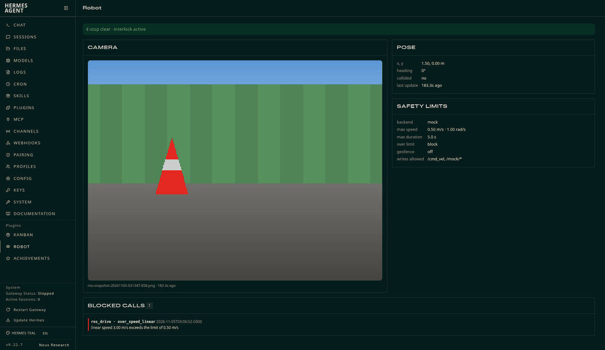
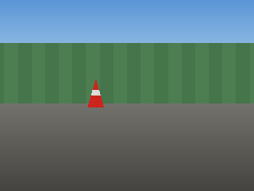
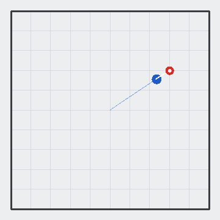
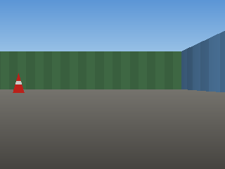
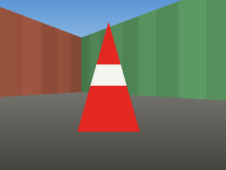

# hermes-ros

**Let a Hermes agent drive a ROS / ROS 2 robot — with a safety interlock the model cannot talk its way past.**

`hermes-ros` is a [Hermes Agent](https://hermes-agent.nousresearch.com) plugin. It gives the agent nine robot tools
(discover, read odometry, grab a camera frame, drive, call services, e-stop) over a
[rosbridge](https://github.com/RobotWebTools/rosbridge_suite) websocket, and puts every one of them behind a
`pre_tool_call` hook that enforces speed, duration, geofence and write-allowlist limits and a latching e-stop.

It ships with a **built-in mock robot** (a 2D simulator with a rendered camera and a red cone), so you can try the whole
thing in one command with **no ROS, no Docker and no robot** — and so CI can test it.

> "Drive to the red cone." → the agent looks through the camera, turns toward the cone, drives in small verified steps and
> reports what it sees. "Floor it into the wall." → *blocked: linear speed 3.00 m/s exceeds the limit of 0.50 m/s*.

**The Robot tab in `hermes dashboard`** (read-only: live camera frame, pose, active limits, e-stop state and the blocked-call log):



| Camera at start (mock) | Camera after the approach | Top-down path (mock) |
|---|---|---|
|  |  |  |

Real ROS 2 Jazzy + rosbridge + turtlesim, camera frames grabbed through the plugin (see [Real ROS check](#verification)):

| Before | After driving to the cone |
|---|---|
|  |  |

## Quickstart (mock robot, one command)

Offline demo, runs the real tool handlers and interlock, no dependencies beyond Python 3.10+:

```bash
git clone https://github.com/arcabotai/hermes-ros && python3 hermes-ros/demo/mock_demo.py
```

Use it from Hermes (mock mode is the default):

```bash
hermes plugins install arcabotai/hermes-ros --enable
hermes chat -t ros,vision -q "Look through the robot's camera and tell me what you see, then drive to the red cone."
```

Inside a Hermes session, `/ros` is for the **human**: `/ros status`, `/ros estop [reason]`, `/ros clear`, `/ros log`,
`/ros snapshot`, `/ros stop`, `/ros help`.

## Quickstart (real ROS 2 in Docker)

```bash
docker compose up --build        # ROS 2 Jazzy + rosbridge_server + turtlesim + a synthetic camera on ws://localhost:9090
```

Then merge [`docker/hermes-config.example.yaml`](docker/hermes-config.example.yaml) into `~/.hermes/config.yaml`
(it switches `backend` to `rosbridge` and points the topics at turtlesim) and ask the agent to drive.
Turtlesim has no camera, so `docker/fake_camera.py` publishes a synthetic `sensor_msgs/Image` +
`CompressedImage` of what the turtle "sees" (a red cone at (8.5, 7.5)). For a real robot, point
`rosbridge.host` / `topics.*` at it; see [Config reference](#config-reference).

TurtleBot3 on ROS 2 Jazzy expects `geometry_msgs/TwistStamped` on `/cmd_vel`: set `topics.cmd_vel_type: geometry_msgs/msg/TwistStamped`.
(Gazebo / TurtleBot3 was **not** exercised for this submission; see [Limitations](#limitations).)

No Docker? `scripts/blaxel_e2e.py` builds the same stack (ROS 2 Jazzy in an Ubuntu chroot), runs the full test
suite against it, copies back logs and camera frames, and deletes the sandbox — that is how this repo was verified.

## Tools

| Tool | What it does |
|---|---|
| `ros_status` | Backend, connection, active limits, geofence, allowlists, e-stop state, recent blocked calls |
| `ros_list` | Topics (with types), services and nodes (via `rosapi`) |
| `ros_echo` | Read one message from a topic (big arrays/images are summarised) |
| `ros_get_pose` | x, y, yaw, velocities, data age, collision flag (nav_msgs/Odometry or turtlesim/Pose) |
| `ros_camera_snapshot` | One `Image`/`CompressedImage` frame → PNG/JPEG file; returns `MEDIA:<path>` + a `vision_analyze` hint (or an inline multimodal result with `camera.return_mode: inline`) |
| `ros_drive` | Velocity command for `duration_s`, 10 Hz, then an automatic stop; returns pose before/after |
| `ros_publish` | Publish any message to an **allowlisted** topic (optionally repeated) |
| `ros_call_service` | Call an **allowlisted** service |
| `ros_stop` | Zero-velocity burst; `estop=true` also latches the e-stop |

**Dashboard tab (optional, read-only).** `hermes dashboard` shows a **Robot** tab: the latest camera frame, pose, active
limits, e-stop state and the blocked-call log, refreshed every 1.5 s. It only *reads* files the plugin already writes
(it has no controls on purpose: the e-stop latch is cleared by a human with `/ros clear`, never from a web button).
Its API is mounted under `/api/plugins/hermes-ros/` and needs the dashboard session token like every plugin route.

A bundled skill, `ros-safe-operation`, teaches the agent the pre-flight checklist, the *look → one small move → verify*
loop, how to read refusals, and e-stop discipline.

## Safety model

All checks run in a `pre_tool_call` hook, before the handler. A blocked call is returned to the model as an explanation
(so it can adapt) and is **logged** with its reason: in memory, to `blocked.jsonl`, and to the Hermes log.

| Rule | Blocks (or clamps, with `over_limit_action: clamp`) |
|---|---|
| `over_speed_linear` / `over_speed_angular` | commanded speed above `max_linear_mps` / `max_angular_rps` (also inside `ros_publish` Twist messages) |
| `over_duration` | a command longer than `max_duration_s` |
| `topic_not_allowlisted` / `service_not_allowlisted` | writes to anything not in `write_allowlist` (glob patterns) |
| `geofence`, `geofence_no_odom`, `geofence_odom_stale` | motion whose projected path leaves the rectangle (latest odom + a kinematic projection + margin); no/stale odometry blocks motion when the geofence is on; during the move the loop aborts and stops the robot if odom shows a breach |
| `estop_latched` | all motion and service calls, until a **human** runs `/ros clear` |
| `unparseable_motion_message` | publishes to `*cmd_vel*` topics that are not a readable Twist |
| `invalid_args`, `interlock_error`, `interlock_not_applied` | malformed args; any crash in the checks (**fails closed**); a handler invoked without the hook having run |

Design points:
* **Fail closed.** The hook stamps each call with a per-process nonce; handlers refuse to act without it, so a skipped or
  crashed hook cannot silently turn into unchecked motion. Zero-velocity commands and `ros_stop` are never blocked.
* **The e-stop latch persists on disk** (`estop.json`) and can only be cleared through the human-only `/ros clear`
  command — there is no tool for it.
* **Config, not environment variables.** All limits live in the plugin's `settings`; the plugin adds no `HERMES_*` env vars.
* The mock backend enforces the same pipeline, so the safety behaviour you test in mock is the behaviour on the robot.

**What this does not protect against:** the interlock covers the `ros_*` tools. An agent with a terminal tool, or anyone
who can edit your config or reach the rosbridge port, can bypass it. It is not a replacement for a hardware e-stop, a
velocity limiter in the robot's own stack, or obstacle avoidance. The geofence relies on odometry (dead reckoning in the
odom frame) and drifts. Use a real e-stop on real hardware.

## Config reference

Set under `plugins.entries.hermes-ros.settings` in `~/.hermes/config.yaml` (read on every call; no restart needed). Defaults shown.

```yaml
plugins:
  entries:
    hermes-ros:
      settings:
        backend: mock                    # mock | rosbridge
        rosbridge: {host: localhost, port: 9090, connect_timeout_s: 6.0, call_timeout_s: 8.0}
        topics:
          cmd_vel: /cmd_vel
          cmd_vel_type: geometry_msgs/Twist     # TurtleBot3 on Jazzy: geometry_msgs/msg/TwistStamped
          odom: /odom
          odom_type: nav_msgs/Odometry          # turtlesim: turtlesim/msg/Pose on /turtle1/pose
          camera: /camera/image_raw             # Image or <topic>/compressed
        camera:
          timeout_s: 6.0
          output_dir: ""                 # default <HERMES_HOME>/plugin-data/<plugin>/snapshots
          keep_last: 20                  # older snapshots are deleted
          return_mode: path              # path (MEDIA: + vision_analyze hint) | inline (multimodal result)
        safety:
          max_linear_mps: 0.5
          max_angular_rps: 1.0
          max_duration_s: 5.0
          default_duration_s: 1.0
          over_limit_action: block       # block | clamp
          max_publish_rate_hz: 30.0
          geofence: {enabled: false, x_min: -4.0, x_max: 4.0, y_min: -4.0, y_max: 4.0, max_odom_age_s: 5.0, margin_m: 0.25}
          write_allowlist:
            topics: ["/cmd_vel"]         # glob patterns
            services: ["/mock/*"]
          motion_topic_patterns: ["*cmd_vel*"]
          blocked_log_max: 500
        mock:
          half_x: 5.0
          half_y: 5.0
          start: {x: 0.0, y: 0.0, yaw: 0.0}
          cones: [{x: 3.0, y: 2.0}]
          realtime: false                # true: sleep in real time while the sim runs
          persist: true                  # keep the robot pose between runs
```

## Disclosure

* **Network:** in `rosbridge` mode the plugin opens one websocket to the **rosbridge server you configure**
  (`ws://<rosbridge.host>:<rosbridge.port>`, default `localhost:9090`) and talks only to it, lazily on the first tool call —
  nothing is opened at import or registration time. In `mock` mode (the default) it makes **no network connections**.
* **Files written** (all under `<HERMES_HOME>/plugin-data/<plugin>/` unless you set `camera.output_dir`): camera snapshots
  (`snapshots/`, pruned to `keep_last`), the blocked-call audit log (`blocked.jsonl`), the e-stop latch (`estop.json`), the last pose (`last_pose.json`, read by the dashboard tab) and,
  in mock mode, the simulated pose (`mock_state.json`). The dashboard tab only reads these.
* **Credentials:** none. The rosbridge websocket is unauthenticated, as rosbridge usually is; keep it on a trusted network.
* **Dependencies:** `websocket-client` (pure Python; already part of Hermes's lock). No ROS installation is needed on the Hermes host.
* **Physical effects:** with a real robot attached, the agent can move it. Read [Safety model](#safety-model).

## Verification

Everything below was actually run (logs in [`docs/verification/`](docs/verification)):

| Check | Result |
|---|---|
| `pytest tests` (interlock, mock tools, registration, imaging, rosbridge protocol against an in-process fake server) | **79 passed**, 10 skipped (live) |
| Same suite + live tests against **real ROS 2 Jazzy + rosbridge_server + turtlesim** in a Blaxel sandbox (`scripts/blaxel_e2e.py`) | **85 passed**, 1 skipped (the dashboard-API test module needs fastapi, absent in the sandbox) — incl. real `Image` + `CompressedImage` snapshots, drive/stop, over-speed and geofence blocks, allowlists, e-stop latch, closed-loop drive to the cone |
| `hermes plugins validate <clone> --install-deps` | Validation passed (all checks ✓, security scan "safe") |
| `hermes plugins doctor <installed>` | OK: discovery, manifest, import, registration — 9 tools, 1 hook |
| Dashboard API under the real `hermes dashboard` | `GET /api/plugins/hermes-ros/state` → 401 without the session token, 200 with it (pose, limits, blocked calls); tab rendered in a real browser (camera frame, pose, limits and blocked-call log all render, 0 console errors) |
| `hermes plugins install arcabotai/hermes-ros` + `enable` in a throwaway `HERMES_HOME`, then a scripted `hermes chat` turn against the mock | agent snapshotted, was refused at 3 m/s / 10 s (logged in `blocked.jsonl`), retried within limits |

Run the tests yourself: `pip install -r requirements-dev.txt && cd tests && python -m pytest`
(live tests: `HERMES_ROS_LIVE=localhost:9090 python -m pytest live` against the docker demo).

## Limitations

* The ROS demo camera is **synthetic** (turtlesim has none), rendered by the same raycaster as the mock. TurtleBot3/Gazebo with a real camera was not tested.
* Plain ROS 2 over rosbridge only; no actions/nav2 tools yet, and `ros_publish` sends JSON-typed messages (no binary/large payloads).
* The interlock is advisory against anything that can bypass the tools (see [Safety model](#safety-model)).

## License

MIT — see [LICENSE](LICENSE).

## AI-assistance disclosure

This plugin, its tests, docs and demo were written by an AI agent (Grok Bot) working for Arca Computer, and reviewed by
a human maintainer. The real-ROS verification above was executed by that agent in an ephemeral cloud sandbox.

— Built by an AI agent from Arca. All code here is stewarded and reviewed by Luis Felipe Abarca ([@felirami](https://github.com/felirami)) of Arca Computer, Inc. (https://arca.computer). All Arca OSS contributions: https://oss.arcabot.ai
